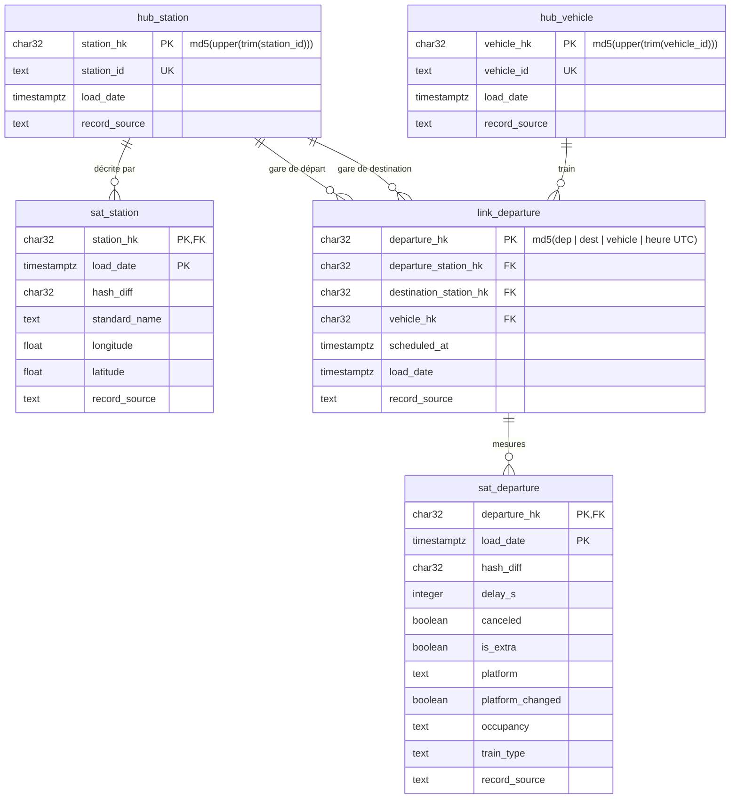

# Data Vault

## Pourquoi un Data Vault à côté de l'étoile
Le Data Vault stocke toutes les données reçues, presque sans les transformer, et en garde **tout l'historique**, avec la date et la source de chaque valeur. Il sert à **intégrer** plusieurs sources au même endroit et à pouvoir **auditer** les données (« d'où vient cette valeur, et depuis quand ? »).

Il se place entre le staging et l'étoile Kimball : le Data Vault est la couche d'intégration, et l'étoile, calculée par-dessus, est la couche d'analyse (Power BI).

```
staging ──▶ Data Vault (schéma dv, insert-only) ──▶ étoile (vues) ──▶ BI
```

Dans ce projet, il est construit **à côté** de l'étoile existante, à partir des mêmes stagings, pour comparer les deux méthodes.

## Le modèle


## Les choix
- **Clés de hachage** : la clé est le MD5 de la clé métier. C'est une **fonction** : le même identifiant donne toujours la même clé, en SQL comme en Python. On peut donc calculer la clé d'un hub **sans lire le hub**, et charger hubs, links et satellites sans lookup. `upper` et `trim` nettoient l'identifiant avant le hachage, pour que deux valeurs égales ne donnent pas deux clés différentes à cause d'un espace caché ou d'une différence de majuscules. La clé du link hache les 4 éléments qui identifient un départ, séparés par `|`.
- **L'heure en UTC dans la clé** : le texte d'un `timestamptz` dépend du fuseau de la session (`08:37:00+00` contre `10:37:00+02`). Sans `AT TIME ZONE 'UTC'`, le même départ pourrait recevoir deux clés différentes. Les heures sont stockées en UTC et converties en heure de Bruxelles seulement à l'affichage (BI, application) : toutes les machines ont ainsi la même référence.
- **Insert-only** : on ne modifie et on ne supprime rien. Les hubs et les links ne changent jamais : une clé existe ou n'existe pas (`ON CONFLICT DO NOTHING`). Un satellite reçoit une nouvelle ligne **seulement si le `hash_diff` diffère de la dernière version**. Un 2ᵉ chargement sans changement n'insère donc rien. Test du renommage de Bruxelles-Central, aller puis retour : 715 hubs (inchangé) et 717 versions dans `sat_station`.
- **`dv.v_dim_station`** : la `dim_station` SCD 2 de l'étoile est recalculée par une vue, à partir du hub et du satellite. `LEAD` donne le `valid_to` (la `load_date` de la version suivante), `LAG` repère la première version (`valid_from = 1900-01-01`), et `is_current` vaut « pas de version suivante ». **Preuve** : `EXCEPT` dans les deux sens, entre la vue et la table `dim_station` (sans le membre `-1`), donne 0 et 0. On ne compare pas les dates : la table utilise `snapshot_at` (date de l'API), et le satellite la `load_date` (date du chargement).

## Kimball ou Data Vault ?
- **Je choisirais le Data Vault quand** : il y a beaucoup de sources à centraliser, des règles métier qui changent, et un besoin d'audit et d'historique complet.
- **C'est trop quand** : il y a une seule source, un schéma simple et une petite équipe, sans besoin d'audit. Une étoile Kimball directe suffit, et c'est le cas le plus courant.
- **Constaté ici** : pour le nom de la gare de départ au moment d'un départ, il faut **1 jointure** en Kimball (`fact_departure` → `dim_station`, déjà datée par la clé). En Data Vault, il en faut **2** (`link_departure` → `sat_station`, avec une condition sur les dates pour trouver la bonne version, puis `hub_station` pour avoir le `station_id`). Le Data Vault demande plus de tables et plus de jointures, mais il garde tout.
- **Si demain `dim_station` doit passer en SCD 1** : on ne recharge **rien**. Le Data Vault a gardé toutes les versions ; il suffit de changer la vue pour ne garder que la dernière version de chaque gare. En Kimball seul, l'historique écrasé serait perdu.

## Limites actuelles
- `stg_departure` est vidé à chaque `irail-load-facts` et ne contient que **le dernier jour chargé**. `data_vault_load.sql` seul ne charge donc qu'un jour.
- **Solution provisoire** : `scripts/load_data_vault.sh` recharge tout le Data Vault par un lancement manuel, jour par jour (`irail-load-facts <jour>` remplit le staging, puis `data_vault_load.sql` le lit). Résultat : 12 606 links = 12 606 faits, sur 15 jours.
- **Sa limite** : le Data Vault dépend du staging de l'étoile, et chaque jour rechargé ajoute une 2ᵉ ligne `success` dans `etl_load_log`.
- **La cible (S3)** : charger le Data Vault avec dbt, directement depuis la silver, pour le lancer automatiquement, le découpler du staging de l'étoile et laisser dbt gérer l'ordre des dépendances.
